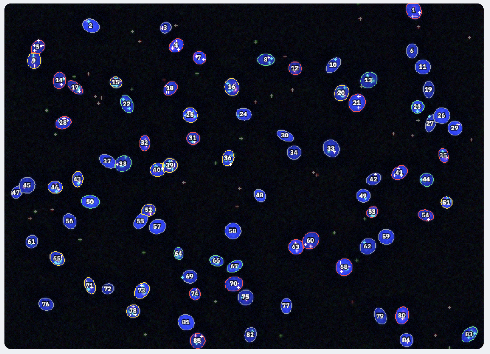

# 核カウンター（Nuclei Counter）

蛍光顕微鏡画像（DAPI・赤・緑）から、**核の数**と、**赤・緑のドット状シグナルが重なる核（共発現）の数**を自動で数えるWebアプリです。ブラウザだけで動き、インストールは不要です。画像は使っている端末の中だけで処理され、外部には送信されません。

**▶ アプリを開く：https://yikejiri.github.io/nuclei_counter**



## 主な機能

- **フォルダ単位の一括処理**：DAPI・赤・緑の3つのフォルダを選ぶと、ファイル名順に組み合わせて全画像を解析します。
- **2つの進め方**：「自動で一括処理」（閾値は画像ごとに自動計算、または全画像で固定）と、「1枚ずつ確認」（閾値の調整や誤検出の除外をしながら進める）を選べます。
- **核の検出**：大津法による二値化と、Watershed法による接触核の分割を行います。
- **ドットの検出**：トップハット変換で高い背景やムラを除去してから、ドット状シグナルを検出します。
- **共発現の判定**：核ごとに赤・緑のドット数を数え、規定数以上なら陽性とします（赤のみ／緑のみ／共陽性／陰性）。
- **結果の保存**：集計CSV、核ごとのCSV、判定画像（元画像版と背景除去後の版）、設定の記録をZIPにまとめて保存します。
- **対応形式**：TIFF（8／16ビット）、PNG、JPEGを読み込めます。

## 使い方

1. 「フォルダを選択」で、DAPI・赤・緑それぞれの画像フォルダを選びます。
2. 左の一覧で、3つの画像の組み合わせが正しいことを確認します。
3. 進め方（自動／1枚ずつ）を選び、必要に応じて設定を調整します。
4. 「解析を開始」を押します。
5. 終わったら「結果をZIPで保存」を押します。

まずは「サンプル（4組）で試す」で、合成画像を使って流れを確認できます。

## 出力されるファイル

```
results_YYYYMMDD_HHMM/
├── summary.csv            組ごとの集計（最後の行が合計）。画像ごとの閾値も記録
├── settings.txt           解析条件と方法の記録
├── nuclei_data/           核ごとのデータ（番号・位置・面積・ドット数・判定）
├── overlay_images/        元の画像に判定を重ねた画像
└── overlay_images_bgsub/  背景除去後の画像に判定を重ねた画像
```

判定画像の見方：輪郭の色は、黄＝共陽性、赤＝赤のみ、緑＝緑のみ、灰＝陰性を表します。十字は白＝赤ドット、水色＝緑ドットで、数字は `nuclei_data` の `nucleus_id` と対応します。

## 解析の仕組み

1. **正規化**：各チャンネルの明るさを0〜255にそろえます（下位0.1％〜上位0.05％を基準）。
2. **核の検出**：DAPIにガウシアン平滑化をかけ、閾値で二値化します（自動の場合は大津法）。核内の穴を埋めたあと、距離変換に基づくマーカー付きWatershed法で接触した核を分割し、面積で選別します。
3. **背景除去**：赤・緑にガウシアン平滑化（σ=1）をかけたあと、ホワイトトップハット変換（オープニング画像を差し引く処理）で、ドットより大きく広がった背景を取り除きます。
4. **ドットの検出**：背景除去後の画像で、閾値を超える局所最大点をドットとします。自動閾値は「中央値＋6×MAD×1.4826」です。
5. **判定**：核（必要に応じて外側に拡張した領域）内のドット数が規定数以上なら陽性とします。

## 注意事項

- このツールの結果は、手動計数による検証を前提に利用してください。論文などで使う場合は、数視野で手動計数との一致を確認し、その結果を併記することをおすすめします。
- すべての処理をブラウザ内で行うため、大きな画像や多数の画像を一度に処理すると、動作が重くなることがあります。
- フォルダ選択機能はパソコンのブラウザ（Chrome／Edge推奨）でのみ動作します。

## 使用ライブラリ

- [UTIF.js](https://github.com/photopea/UTIF.js)（MIT License）：TIFFの読み込み
- [pako](https://github.com/nodeca/pako)（MIT License）：TIFFの圧縮データの展開
- [JSZip](https://stuk.github.io/jszip/)（MIT License）：ZIPファイルの作成

## 開発について

研究で行っていた核とドットの手作業での計数を効率化するために開発しました。要件の整理、動作の検証、改善点の洗い出しは作者が行い、コードの作成にはAIアシスタント（Anthropic社のClaude）を活用しています。

## ライセンス

[MIT License](LICENSE)
